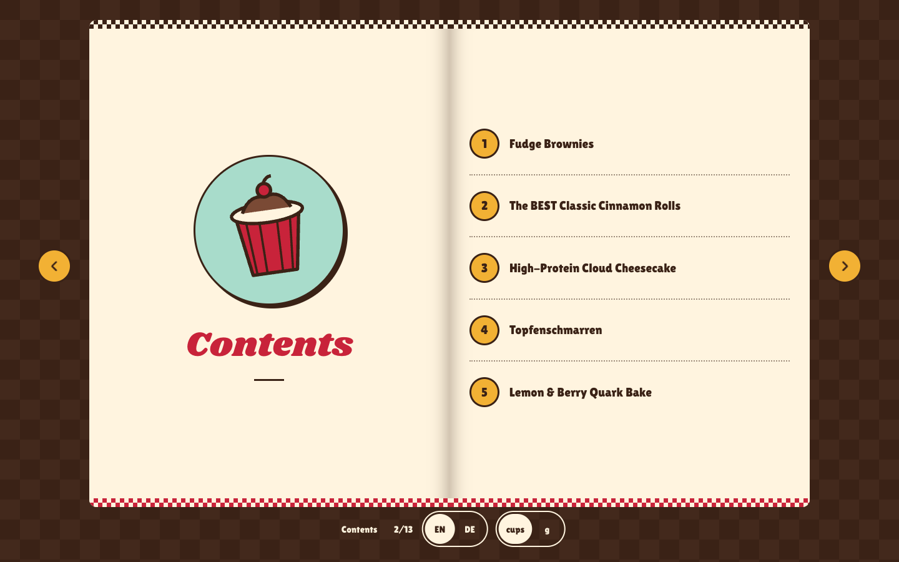

# Joseph's Recipe Book

A flip-through retro diner baking recipe book in English, German, and French. Cups and spoons first, grams on a toggle.

**Live:** https://joseph-kya.github.io/recipe-book/



## Features

- **Book swipe & pagination** — spring-driven page turns via touch, trackpad, or keyboard, with two-page spreads on wide screens and single-column reading on phones.
- **Search & quick tools** — search recipes and ingredients from the contents page, pick a random recipe, scale portions (`½×`–`3×`), or download printable PDF sheets (cups or grams).
- **Cook mode & timers** — step-by-step cook view with screen wake lock, checkable ingredients, and tap-to-start timers parsed from recipe steps.
- **Favorites & baked counts** — heart recipes and track how many times each one has been baked.
- **Profiles** — switch between up to six "who's baking?" profiles, each with its own favorites and baked counts.
- **Google sign-in sync** — optional Firebase Auth + Cloud Firestore sync merges favorites, baked counts, and profiles across devices (works locally via `localStorage` without it).
- **Offline PWA** — installable web app with a service worker that caches recipes, fonts, and assets for offline kitchen use.
- **Feedback & recipe suggestions** — built-in forms on the contents page to send feedback or suggest a recipe when Firebase is configured.

## Tech Stack

- **Frontend:** React 19, Vite 7, plain CSS (Retro Diner theme + dark mode toggle)
- **Layout & motion:** custom spring physics and build-time recipe/language chunking (`vite.config.js`)
- **Typography:** self-hosted OFL fonts (`Shrikhand`, `Lilita One`, `Kalam`, `Nunito`)
- **Sync & backend (optional):** lazy-loaded Firebase Auth (Google) + Firestore Lite, zero-backend static hosting on GitHub Pages
- **Tests:** Node test runner (`node --test`) + Playwright & axe-core

## Run Locally

```bash
npm i
npm run dev      # local dev server
npm test         # unit, content, and Playwright tests
npm run build    # static production build into dist/
```

## Adding Recipes

Recipes are data-driven JSON + PDF files with no code changes needed. See [ADDING_RECIPES.md](ADDING_RECIPES.md).

## Google Sign-In & Feedback Setup

Sign-in sync, feedback, and recipe suggestions are enabled by providing four `VITE_FIREBASE_*` build-time variables in a local `.env` (see `.env.example`). Without them, the app builds without Firebase and stores data in `localStorage`. See [AUTH_SETUP.md](AUTH_SETUP.md).

## Deploy

```bash
npm run deploy
```

Builds `dist/` and pushes it to the `gh-pages` branch via `scripts/deploy.sh` for GitHub Pages.

## Credits

Recipes and printable PDFs are credited to their original sources on each page. Fonts are licensed under the SIL Open Font License 1.1 (`assets/fonts/LICENSE-fonts.txt`).
