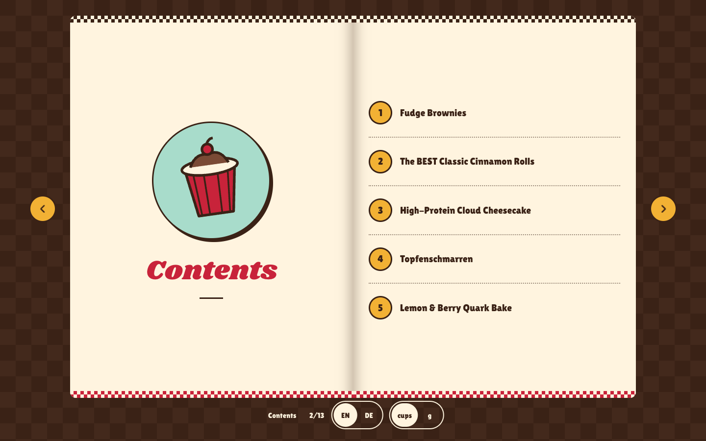

# Joseph's Recipe Book

My baking recipes as a little book you flip through. Cups and spoons first, grams on a toggle, in English and German.

**Live:** https://joseph-kya.github.io/recipe-book/



## Stack

Vite + React, plain CSS, no backend. The page turns are hand-written springs, and a small paginator lays each recipe into fixed book pages on wide screens. Fonts are self-hosted.

## Run it

```bash
npm install
npm run dev       # local dev server
npm run build     # static build into dist/
npm run deploy    # build and publish to GitHub Pages (gh-pages branch)
```

## Add a recipe

1. Add `content/recipes/<slug>.json` (same shape as the existing ones).
2. Add its sheet at `content/pdfs/<slug>.pdf`, and optionally `<slug>.grams.pdf` for the metric sheet.
3. Build. Recipes are ordered by their JSON `number` and numbered 1, 2, 3… by position.

Each recipe can be scaled ½×–3×. Amounts written like `1 cup + 2 tbsp`, `1 Tasse + 2 EL`, `175 g` or `4` scale; anything else (`to taste`, `a splash`) shows as written. The rules live in `src/scale.js`; `npm test` checks them against every recipe.

## Credits

Recipes and printable PDFs come from my Bread Pitt baking bot, credited to their original sources on each page. The design is in a Retro Diner style. Fonts: Shrikhand, Lilita One, Kalam, Nunito (OFL).
